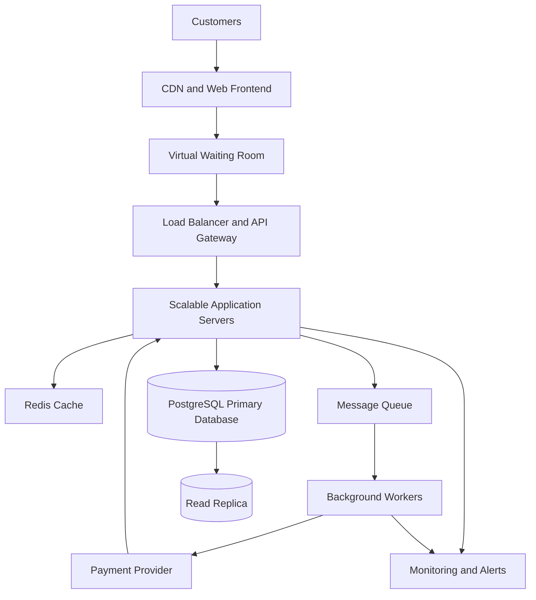

# TicketHub System Design
## 1. Requirements

TicketHub is an online ticketing website where users can browse concerts and events, view available seats, reserve seats temporarily, pay for orders, and access their purchased tickets.

### 1.1 Functional Requirements

1. **User accounts:** Users can register, sign in, and view their account details.
2. **Browse events:** Users can view upcoming concerts and events, search by name, and filter by date or location.
3. **View seats:** Users can view a venue's seats and their availability.
4. **Hold seats:** Users can temporarily hold available seats while completing checkout.
5. **Make payments:** Users can pay for held seats and receive confirmation of a successful order.
6. **View tickets:** Users can view their purchased tickets and order history.
7. **Manage events:** Authorized administrators can create events, configure seats, and manage ticket availability.

### 1.2 Non-Functional Requirements

- **Speed:** Event pages should load within two seconds under normal conditions. Seat availability and checkout requests should respond quickly, with clear feedback when demand is high.
- **Correctness:** A seat must never be sold to two customers. Orders and payments must be recorded accurately, and failed payments must not result in confirmed ticket purchases.
- **Fairness:** Customers should be processed through a fair, controlled queue during popular sales. The system should limit automated abuse and prevent users from repeatedly holding large numbers of seats.
- **Scalability:** The system must support two million registered users and handle sudden increases in traffic when popular concerts go on sale.
- **Availability:** Browsing and purchasing should remain available during high demand, with graceful handling of temporary service failures.
- **Security:** Users must access only their own orders and tickets. Payment information must be handled securely, and sensitive card details should not be stored directly by TicketHub.
- **Consistency:** Seat availability, seat holds, orders, and confirmed purchases must remain consistent even when multiple customers attempt to buy the same seat.
- **Reliability:** Payment requests must be safe to retry without accidentally charging customers twice or creating duplicate orders.

## 2. Traffic Estimates

TicketHub has 2 million registered users. Traffic estimates help determine the capacity required for normal operations and the sudden demand created by a popular concert sale.

### 2.1 Normal Traffic

On a normal day:
- Daily visitors: 50,000
- Pages viewed per visitor: 10
- Tickets sold per day: 5,000

**Daily page views**

50,000 visitors × 10 pages = 500,000 page views per day.

**Average page requests per second**

500,000 ÷ 86,400 seconds = approximately 5.8 page requests per second.

This is an average. Actual traffic will vary throughout the day, so the system should support substantially higher short-term demand.

**Average ticket sales rate**

5,000 tickets ÷ 86,400 seconds = approximately 0.058 tickets per second, or 208 tickets per hour on average.

### 2.2 Popular Concert Sale

For a popular concert:
- People attempting to buy tickets: 200,000
- Seats available: 20,000
- Sale window: 10 minutes (600 seconds)

**Average incoming purchase attempts per second**

200,000 ÷ 600 = approximately 333 purchase attempts per second.

**Average seat sales required to sell all available seats within 10 minutes**

20,000 ÷ 600 = approximately 33 successful seat sales per second.

**Demand compared with supply**

200,000 people compete for 20,000 seats. There are 10 people attempting to buy for every available seat, so only 10% of those people can obtain a seat if each person buys one.

### 2.3 Comparison and Capacity Planning

The popular sale generates approximately 333 purchase attempts per second, compared with about 5.8 page requests per second as the normal daily average. Purchase attempts alone are therefore roughly 57 times the normal average page-request rate.

These figures are averages, not maximum instantaneous loads. The sale may experience much sharper bursts when tickets first become available.

TicketHub should use a virtual waiting room, rate limiting, caching for event pages, and horizontally scalable application servers. Seat allocation and payment processing should be protected by database transactions and controlled concurrency rather than relying on application-server scaling alone. The system must reject or queue excess demand without selling more than the 20,000 available seats.

## 3. API Design

TicketHub uses a REST API over HTTPS. The API returns JSON responses and requires authentication for actions involving seat holds, payments, orders, and tickets.

| Method | Endpoint | Purpose |
|---|---|---|
| GET | `/api/events` | Browse, search, and filter upcoming events. |
| GET | `/api/events/{eventId}` | View event details, including venue and sale information. |
| GET | `/api/events/{eventId}/seats` | View seats and their current availability. |
| POST | `/api/seat-holds` | Temporarily hold one or more available seats for the authenticated user. |
| DELETE | `/api/seat-holds/{holdId}` | Release a user's held seats before the hold expires. |
| POST | `/api/orders` | Create an order for seats held by the authenticated user. |
| POST | `/api/orders/{orderId}/payments` | Initiate payment for an order through a payment provider. |
| GET | `/api/orders/{orderId}` | View order status and payment outcome. |
| GET | `/api/me/tickets` | List tickets belonging to the authenticated user. |
| GET | `/api/me/tickets/{ticketId}` | View details of one ticket owned by the authenticated user. |

### 3.1 Example Request: Hold Seats

`POST /api/seat-holds`


Example JSON request:

```json
{
  "eventId": 101,
  "seatIds": [501, 502]
}
```

The server checks that the event is on sale and that both seats are available. It then attempts to reserve them atomically in a database transaction. If either seat cannot be held, the entire request fails rather than leaving the user with only part of the requested selection.

A successful response returns a hold ID, the held seat IDs, and an expiration timestamp. For example, the hold might expire after five minutes.

### 3.2 Example Request: Make Payment

`POST /api/orders/9001/payments`

The server verifies that the order belongs to the authenticated user and that the associated seat holds are still valid. It sends the payment request to an external payment provider and records the payment status.

The client should supply an idempotency key for payment requests. Repeating a request with the same key must not create a duplicate charge or order. A verified payment-provider response or webhook updates the order to paid and confirms the tickets.

### 3.3 API Error Handling

The API uses appropriate HTTP status codes:

- `200 OK` for successful retrieval or actions.
- `201 Created` for successfully created holds or orders.
- `400 Bad Request` for invalid input.
- `401 Unauthorized` when authentication is missing or invalid.
- `403 Forbidden` when a user lacks permission to access a resource.
- `404 Not Found` when a requested resource does not exist or is not accessible.
- `409 Conflict` when a seat is already held or sold, or a hold has expired.
- `429 Too Many Requests` when a client exceeds its rate limit.
- `503 Service Unavailable` when the service is temporarily unable to accept requests.

The API must never rely on the browser alone to decide whether a seat is available or a payment succeeded. These decisions are verified by the server and persisted in the database.

## 4. Data Model and Relationships

TicketHub uses a relational database such as PostgreSQL because transactions, foreign keys, and unique constraints help protect ticket inventory and maintain data integrity.

The database contains the following core tables.

### 4.1 Users

Stores registered customer accounts.

| Column | Type | Description |
|---|---|---|
| `user_id` | BIGINT, primary key | Unique user identifier. |
| `name` | VARCHAR | Customer's name. |
| `email` | VARCHAR, unique | Login email address. |
| `password_hash` | VARCHAR | Securely hashed password. |
| `created_at` | TIMESTAMP | Account creation time. |

### 4.2 Events

Stores concerts and other events.

| Column | Type | Description |
|---|---|---|
| `event_id` | BIGINT, primary key | Unique event identifier. |
| `event_name` | VARCHAR | Event name. |
| `venue` | VARCHAR | Venue name or location. |
| `starts_at` | TIMESTAMP | Event start time. |
| `sale_starts_at` | TIMESTAMP | Ticket sale opening time. |
| `status` | VARCHAR | For example, scheduled, on sale, or cancelled. |

### 4.3 Seats

Stores the seats available for each event.

| Column | Type | Description |
|---|---|---|
| `seat_id` | BIGINT, primary key | Unique seat record identifier. |
| `event_id` | BIGINT, foreign key | References `Events.event_id`. |
| `seat_number` | VARCHAR | Seat label, such as A-12. |
| `price` | DECIMAL | Ticket price for this seat. |
| `status` | VARCHAR | Available, held, or sold. |
| `hold_expires_at` | TIMESTAMP, nullable | Expiration time of a temporary hold. |
| `held_by_user_id` | BIGINT, nullable, foreign key | References `Users.user_id` for the current hold. |

A unique constraint on `(event_id, seat_number)` ensures that the same seat label is not entered twice for one event.

### 4.4 Orders

Stores customer purchase orders.

| Column | Type | Description |
|---|---|---|
| `order_id` | BIGINT, primary key | Unique order identifier. |
| `user_id` | BIGINT, foreign key | References `Users.user_id`. |
| `status` | VARCHAR | Pending, paid, cancelled, or expired. |
| `total_amount` | DECIMAL | Total order amount. |
| `created_at` | TIMESTAMP | Order creation time. |

### 4.5 Order Items

Stores the seats included in each order.

| Column | Type | Description |
|---|---|---|
| `order_item_id` | BIGINT, primary key | Unique order-item identifier. |
| `order_id` | BIGINT, foreign key | References `Orders.order_id`. |
| `seat_id` | BIGINT, foreign key | References `Seats.seat_id`. |
| `price_at_purchase` | DECIMAL | Price recorded when the order was created. |

A unique constraint on `seat_id` in `Order Items` prevents a seat from being associated with more than one order item. When an order expires or is cancelled before purchase, its unpaid order items must be removed or handled through an appropriately designed inventory-allocation model so the seat can be sold again.

### 4.6 Payments

Stores payment attempts and their outcomes.

| Column | Type | Description |
|---|---|---|
| `payment_id` | BIGINT, primary key | Unique payment identifier. |
| `order_id` | BIGINT, foreign key | References `Orders.order_id`. |
| `provider_reference` | VARCHAR, unique | Payment provider's transaction reference. |
| `idempotency_key` | VARCHAR, unique | Prevents duplicate processing of the same request. |
| `amount` | DECIMAL | Amount submitted for payment. |
| `status` | VARCHAR | Pending, successful, or failed. |
| `created_at` | TIMESTAMP | Payment attempt creation time. |

### 4.7 Table Relationships

- One user can create many orders: `Users` to `Orders` is one-to-many.
- One event has many seats: `Events` to `Seats` is one-to-many.
- One user can temporarily hold multiple seats, while each seat has at most one active holder.
- One order contains one or more order items: `Orders` to `Order Items` is one-to-many.
- Each order item references one seat. A seat can appear in at most one order item under the unique constraint described above.
- One order can have multiple payment attempts: `Orders` to `Payments` is one-to-many. Unique provider references and idempotency keys prevent duplicate processing of the same payment event or request.

Foreign keys ensure that orders, seats, and payments cannot reference records that do not exist. Database constraints and transactions enforce the rules even when requests arrive concurrently.

## 5. Preventing Double-Booking

TicketHub must guarantee that one seat cannot be sold to two customers, even when thousands of purchase requests arrive at the same time. The application must not rely only on checking seat availability before updating it, because two requests could both see the same seat as available.

### 5.1 Atomic Database Transactions

When a customer requests a seat hold, the server starts a database transaction and locks the requested seat rows using `SELECT ... FOR UPDATE`. The lock ensures that competing transactions cannot simultaneously modify the same seat records.

Within the transaction, the server checks that each seat belongs to the requested event, is available, and is eligible for sale. It then changes the seat status to `held`, records the holding user's ID, and sets a hold expiration time. The transaction commits only if all requested seats can be held. Otherwise, it rolls back, leaving the seats unchanged.

For example, if Alice and Bob both request seat A-12, Alice's transaction may acquire the row lock first. Bob must wait. Once Alice's transaction commits, Bob sees that the seat is held and receives a `409 Conflict` response. Only Alice obtains the hold.

### 5.2 Database Constraints

Transactions are supported by database constraints:

- A primary key uniquely identifies every seat record.
- A unique constraint on `(event_id, seat_number)` prevents duplicate seat definitions for an event.
- A unique constraint on `Order Items.seat_id` prevents the same seat from being assigned to multiple order items.
- Foreign keys ensure that order items reference valid seats and orders.

The application must also enforce valid state transitions so that a sold seat cannot return to available status through an ordinary hold request.

### 5.3 Hold Expiration

A seat hold is temporary. When its expiration time passes, the system may release the seat only if it is still held and the hold has not been converted into a paid order.

The release operation must use a conditional update or transaction that verifies the current hold and expiration time. This prevents a delayed expiration job from releasing a seat that has already been purchased or re-held by another customer.

### 5.4 Payment and Final Confirmation

Creating a hold does not mean the ticket has been sold. TicketHub creates an order for the held seats and processes payment through an external payment provider.

After receiving verified payment confirmation, the server uses a database transaction to verify the order, hold ownership, and seat state before marking the order as paid and the seats as sold. The transition must be conditional and atomic, so a seat cannot be sold twice.

If payment processing is delayed, the system must coordinate hold expiration with the payment state. It must not release a seat while a valid payment is being finalized without first resolving that payment attempt. Payment-provider webhooks must be verified, and duplicate notifications must be handled idempotently.

### 5.5 Why This Works

Row-level locks serialize competing updates to the same seats. Transactions ensure that a group of seats is held or released as one operation. Unique constraints provide an additional database-level safeguard against duplicate seat assignments.

The waiting room and rate limits reduce excessive demand, but they are not the mechanisms that guarantee correctness. The database transaction and constraints are the final protection against double-booking.
### 5.6 Example PostgreSQL Transaction for Holding a Seat

The following SQL illustrates how TicketHub safely holds one seat. The application must execute these statements within a database transaction.

```sql
BEGIN;

SELECT seat_id, status, hold_expires_at
FROM Seats
WHERE seat_id = 501
  AND event_id = 101
FOR UPDATE;

-- After acquiring the row lock, the application checks
-- whether the seat is available or its previous hold expired.

UPDATE Seats
SET status = 'held',
    held_by_user_id = 25,
    hold_expires_at = CURRENT_TIMESTAMP + INTERVAL '5 minutes'
WHERE seat_id = 501
  AND event_id = 101
  AND (
      status = 'available'
      OR (
          status = 'held'
          AND hold_expires_at <= CURRENT_TIMESTAMP
      )
  );

-- The application must verify that exactly one row was updated.
-- If no row was updated, roll back and return HTTP 409 Conflict.

COMMIT;
```

The application must verify the seat's current state after obtaining the row lock and confirm that exactly one row was updated. If the seat is already held by another customer or has been sold, the transaction must not create a new hold.

When Alice and Bob request seat 501 concurrently, the database serializes their conflicting row updates. If Alice successfully holds the seat first, Bob's transaction sees the updated state after obtaining the lock and cannot claim the same seat. The conditional update provides an additional safeguard.

For multiple seats, TicketHub should lock the requested seat rows in a consistent order and verify that every requested seat can be held. If any seat is unavailable, the entire transaction must roll back so the customer does not receive a partial hold.

The final purchase operation must also verify the hold owner, hold expiration, and payment outcome before marking seats as sold. A database constraint and transaction protect inventory correctness even if requests reach different application servers.

This example is illustrative: production code must handle missing seats, transaction errors, lock timeouts, and payment/hold expiration races explicitly.

**Transaction isolation level:** This example uses PostgreSQL's default READ COMMITTED isolation level together with row-level locking (`SELECT ... FOR UPDATE`), conditional updates, and database constraints. When two customers attempt to hold the same seat, the row lock makes their conflicting operations wait for one another. The second transaction then checks the latest committed seat state and cannot claim a seat that is already held by another customer or sold. The application must verify that exactly one row was updated and roll back if the seat is unavailable. A unique constraint on the event and seat number prevents duplicate seat records, while transaction logic ensures that competing requests cannot successfully allocate the same seat twice.

## 6. System Architecture

TicketHub uses a layered architecture with a controlled entry point, scalable application services, and a relational database that protects ticket inventory.

### 6.1 Architecture Diagram



### 6.2 Component Explanations

**1. Customers and Web Frontend**

Customers use the TicketHub website to browse events, view seat availability, complete purchases, and access their tickets. The frontend communicates with the backend through HTTPS APIs.

**2. Content Delivery Network (CDN)**

The CDN serves static assets such as images, stylesheets, JavaScript files, and cached public event information from locations close to users. This reduces latency and limits unnecessary requests to the application servers. It must not serve stale seat availability as authoritative information.

**3. Virtual Waiting Room**

During a popular sale, a virtual waiting room controls how many customers enter the purchasing flow at once. It issues queue positions or access tokens and admits customers at a controlled rate. Fair admission rules, bot detection, and rate limits reduce abuse and protect the backend from sudden traffic spikes.

**4. Load Balancer and API Gateway**

The load balancer distributes requests across healthy application servers. The API gateway applies authentication, request validation, rate limits, and routing rules. Both help prevent any single application server from becoming a bottleneck.

**5. Scalable Application Servers**

Multiple application-server instances process event searches, seat holds, order creation, and ticket retrieval. Instances can scale horizontally as demand increases. Critical inventory operations are executed through safe database transactions rather than relying on in-memory seat locks.

**6. Redis Cache**

Redis stores frequently requested, non-authoritative data such as public event details and session-related information. This reduces repeated database reads. Seat availability must be confirmed against the authoritative database before a hold or purchase is accepted.

**7. PostgreSQL Primary Database**

The primary relational database stores users, events, seats, orders, order items, and payment records. Transactions, row-level locks, foreign keys, and unique constraints protect inventory correctness. All seat-hold and final-sale decisions must be validated against this database.

**8. Message Queue and Background Workers**

The queue buffers asynchronous tasks such as sending confirmation emails, generating ticket documents, and processing non-critical notifications. Background workers process these tasks independently so that the main API remains responsive. The queue must not replace synchronous inventory checks or final purchase validation.

**9. Payment Provider**

An external payment provider securely processes customer payments. TicketHub records payment attempts and verifies provider responses and signed webhooks. Idempotency keys and payment reconciliation help prevent duplicate charges and inconsistent order status.

**10. Read Replica**

A database read replica can serve suitable read-only queries, such as historical reports and selected event information. Replication may lag, so seat availability, active holds, and final purchase decisions must use the primary database.

**11. Monitoring and Alerts**

Monitoring tracks response times, error rates, queue length, database lock waits, failed payments, and inventory conflicts. Alerts help operators identify overload or failures and respond before the entire service becomes unavailable.

### 6.3 Handling the Big Sale

When 200,000 people attempt to buy 20,000 seats within ten minutes, TicketHub uses the following strategy:

1. The CDN serves static content and cached public event details.
2. The waiting room controls entry to the purchase flow and limits the number of concurrent requests reaching the backend.
3. The load balancer distributes admitted requests across multiple application servers.
4. Redis reduces unnecessary reads, while the primary database remains the authority for seat availability.
5. Database transactions and row-level locks serialize competing requests for the same seat. Unique constraints provide additional protection against duplicate sales.
6. A message queue absorbs non-critical background work so email delivery and ticket-document generation do not overwhelm checkout.
7. Monitoring helps operators scale application servers and workers, detect database contention, and adjust admission rates.

The system should be load-tested before a major sale. If the database becomes saturated, the waiting room should slow admission rather than allow unlimited requests to overload inventory operations. This approach prioritizes correct ticket allocation and a stable purchasing experience over accepting every request immediately.

## 7. Design Trade-offs

System design involves balancing competing goals. TicketHub makes the following trade-offs.

### 7.1 Strong Consistency vs. High Availability

TicketHub uses a relational database with transactions and constraints to guarantee that a seat cannot be sold twice. This prioritizes correctness over accepting every purchase request immediately.

During a major sale, row-level locks and competing transactions can increase latency. If the primary database becomes unavailable, purchasing may need to pause rather than accept unverified seat allocations. This is an intentional trade-off because selling the same seat twice would be worse than temporarily delaying checkout.

### 7.2 Fairness vs. Purchase Speed

A virtual waiting room, rate limits, and bot detection help distribute access fairly and protect the backend from traffic spikes. However, customers may have to wait before they can select seats, even when some seats remain available.

Allowing everyone to enter checkout immediately might appear faster, but it could overwhelm the database and give automated buyers an unfair advantage. TicketHub therefore prioritizes controlled admission and a stable experience over immediate access for every visitor.

### 7.3 Caching Performance vs. Freshness

Caching event information and static content reduces database load and improves page speed. However, cached information can become outdated, especially during a popular sale.

TicketHub accepts that public event pages may be briefly stale, but it never treats cached seat availability as final. The primary database validates every hold and purchase, preserving correctness while still benefiting from caching.

### 7.4 Operational Simplicity vs. Scalability

A single application server and database would be simpler and cheaper to operate, but they could become bottlenecks during a major concert sale. Multiple application servers, a waiting room, background workers, caching, and database replicas improve scalability but introduce more operational complexity, monitoring requirements, and infrastructure costs.

TicketHub accepts this additional complexity because its traffic can increase sharply during high-demand sales. The architecture should be introduced and scaled according to measured demand and load-test results.